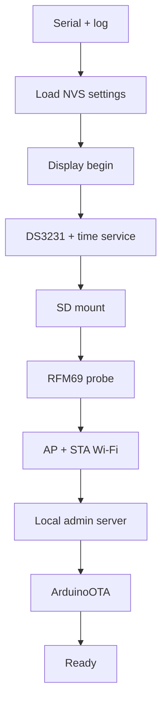

# Firmware architecture

## Layers

```text
sketch .ino        Arduino entry points only
  app.cpp          composition, scheduling, policy
    libraries/     reusable components (no sketch-specific logic)
      ESP32 core / Arduino APIs
```

Sketch folders contain `config.h` (pins, timings) and a small `app.cpp`. The
`.ino` forwards `setup()`/`loop()` so the application can be split into normal
translation units.

## Receiver boot sequence



Nothing after the settings load is allowed to abort boot. Each subsystem sets a
readiness flag; the loop and status page reflect partial availability.

## Main loop

The loop is cooperative and must stay responsive enough for the web server and
OTA. Current sequence:

1. service Wi-Fi reconnect backoff;
2. handle local HTTP requests;
3. handle ArduinoOTA;
4. update display state (throttled);
5. receive one radio frame with a 100 ms timeout;
6. retry SNTP if connected and time invalid;
7. drain at most one queued upload;
7. poll commands/health on an interval (30 s);
8. apply a deferred OTA check;
9. update status/LED (throttled).

Commands are leased without requiring a valid clock, so OTA and diagnostics work
even when the RTC has not been set. The OTA commands are two-step:
`download_new_fw` stages into the inactive slot with streaming SHA-256 and leaves
the boot partition unchanged; `boot_with_new_fw` selects that slot and restarts.
The staged version is recorded in NVS so a boot command cannot select a different
image. Command results are returned in the acknowledgement body.

Blocking calls and their bounds:

| Call | Bound | Notes |
| --- | --- | --- |
| `radio.receive()` | 100 ms | configurable |
| `syncFromNtp()` | 15 s | only when time invalid and online |
| `postObservation()` | connect 5 s, request 10 s | one per loop |
| OTA download | streamed | stalls fail after 15 s without data |

If the touch UI or TLS handshakes increase latency, move networking to a
separate FreeRTOS task or reduce radio timeout. Do not add unbounded blocking
loops to `loop()`.

## Radio seam

`IRadio` exposes packet-oriented receive/transmit. `Rfm69Radio` now implements
the SX1231 packet path used by the Davis ISS: 19.2 kbps FSK, 4.8 kHz deviation,
Gaussian BT=0.5 shaping, `CB 89` sync, fixed eight-byte payload, hardware CRC
off and the 51-entry US frequency table. Register values come from the validated
prototype in `prototype/lib2/DavisRFM69`; see `docs/specs/rf-davis-receive.md`.

The driver owns bit reversal (the ISS sends least-significant bit first), RSSI
sampling, FIFO access and channel changes. It does not decode Davis fields.
`Rfm95Radio` remains the alternate seam. Davis/frame logic must not know which
chip delivered the frame.

`Rfm69Radio` uses the RFM69 DIO0 `PayloadReady` interrupt on GPIO 13. The ISR
only notifies a high-priority FreeRTOS task; it never touches SPI. That task
owns the RFM69 receive loop: it puts the radio in standby before reading the
FIFO, records receive time and channel, runs the channel-hop/search timers, and
enqueues frames into a 128-entry (about 2 KiB) fixed RAM queue. Only frames accepted by the configured
validator enter the queue; invalid noise is counted in `RadioStats` and fed into
the archive `frames_crc_bad` counter. The main loop only decodes, archives
and uploads frames from that queue, so blocking server work (OTA download, SD
replay, command handling) no longer stops RF reception or channel scanning. If
the queue fills, frames are dropped and counted; the event is logged. The task
is pinned to the loop core and does not run on the transmitter simulator
(`RadioConfig::backgroundRx = false`).

The bench transmitter writes the full RFM69 configuration on every boot because
the USB1 board has no RESET connection and the chip retains its previous state.

## Davis seam

`DavisObservation` is the canonical in-memory model. It uses a validity mask
rather than sentinel values, so an absent pressure reading cannot become 0 hPa.
The ported decoder:

1. rejects impossible lengths before parsing;
2. verifies the Davis CRC-16/CCITT and rejects corrupt frames;
3. validates temperature, humidity and wind-direction ranges;
4. sets only fields actually present;
5. never allocates per frame.

`DavisEncoder` mirrors the decoder, including the CRC, and can produce every
ISS message type. The bench simulator adds a wrapping slot sequence in byte 5
(unused by decoded weather fields) so packet gaps can be measured.

`DavisSimulator` is deterministic given a seed, so test failures reproduce. It
produces bounded random walks, not RF modulation. `DavisEncoder` is the matching
seam for the simulator board.

## Settings and provisioning

`SettingsStore` uses NVS via `Preferences`. On a blank device it derives a device
ID `ak-xxxxxx` from the STA MAC and fills development defaults. The bench
firmware seeds `station-1`, the local server URL and credentials from the
git-ignored `secrets.h` only until the first save through the AP page; after
that NVS wins. The AP SSID is `akashavani-<last MAC byte>` and the AP address is
`10.90.0.1`, with a DHCP pool of `10.90.0.11`-`10.90.0.20`. Settings survive
firmware updates unless the NVS partition is erased.

Up to six site Wi-Fi profiles are stored in order and tried sequentially by
`WifiService`. The AP stays active regardless of STA state.

Devices report `X-Device-Mac`, `X-Firmware-Version`, `X-Last-Radio-At`,
`X-Radio-Frames-Valid` and `X-Radio-Rssi` on every API request; the server
stores them on the device row. The live frame count is the current five-minute
bucket, and the live RSSI is that bucket's average (or the last valid frame
until the bucket has samples). The 5-minute archive bucket is emitted even when
no Davis frame was decoded, so radio health (`frames_valid = 0`, null
environmental means) reaches the server every 5 minutes regardless of RF.

The receiver uses an explicit 4 MB table with two 1.875 MiB OTA slots. The
running firmware version is reported with every device request and on the AP
page; OTA download never overwrites the running slot.

Sensitive values (Wi-Fi passwords, cloud token, ArduinoOTA password) are stored
in plain NVS. This is acceptable for the scaffold but should be hardened for
production (encrypted NVS, per-device tokens, physical access assumptions).

## Storage policy

- one JSON object per line, daily files;
- append + flush by default (durability over SD wear);
- no deletion or rotation on the device;
- the card is the source of truth for offline recovery.

If flash or card wear becomes a problem, batch flushes behind a small buffer and
accept losing the last few records on power loss. Make that a deliberate ADR
change.

## Firmware versioning

`firmware/VERSION` is passed to the compiler as `AKASHAVANI_FW_VERSION` by
`tools/fw-build.sh`. The same version is used by OTA tooling and embedded in
`X-Firmware-Version` on uploads. Bump it once per release; do not derive it from
git state on the device.

## Testing boundary

Host tests compile only files with no Arduino dependencies. Anything touching
`Arduino.h`, Wi-Fi, SD, NVS or a display must either:

- isolate its pure logic into a host-safe file, or
- be exercised by `firmware/tests/hardware/bringup`.

This is why `ArchivePath`, the simulator, protocol validation and CRC live apart
from their hardware wrappers.
