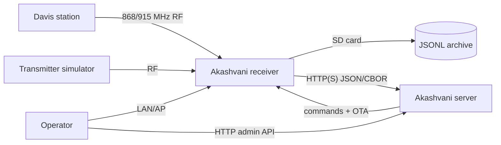
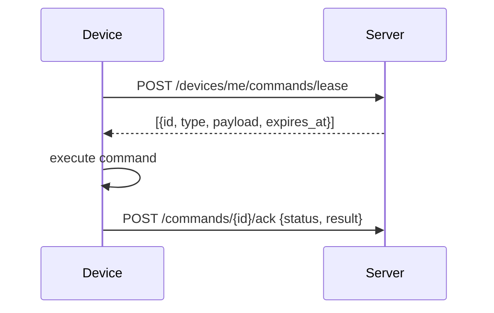

# Architecture overview

## Context



The receiver is the only device that talks to the cloud. The simulator exists
to exercise the receiver's RF path and, through it, the rest of the pipeline.

## Firmware components

| Library | Owns | Does not own |
| --- | --- | --- |
| `AkashvaniCore` | status codes, log, CRC, hex, UTC helpers, IDs | hardware buses |
| `AkashvaniRadio` | `IRadio`, RFM95 registers, mock radio | Davis semantics |
| `AkashvaniDavis` | observation model, frame codec, simulator | radio configuration |
| `AkashvaniProtocol` | version, envelope/command types, field names | JSON library details |
| `AkashvaniStorage` | daily path layout, SD append/flush | cloud policy |
| `AkashvaniNet` | NVS settings, AP+STA, local admin, upload, OTA | measurement decoding |
| `AkashvaniRtc` | DS3231, SNTP, time validity | scheduling policy |
| `AkashvaniDisplay` | display state, no-op driver | data collection |

The dependency graph is acyclic:

```text
sketch/app
  ├─ AkashvaniNet ──> Core, Davis, Protocol, Rtc
  ├─ AkashvaniStorage ──> Core
  ├─ AkashvaniRadio ──> Core
  ├─ AkashvaniDavis ──> Core
  ├─ AkashvaniRtc ──> Core
  └─ AkashvaniDisplay ──> Core
```

## Observation path

1. **Receive.** The radio returns a raw `RadioFrame` with RSSI and a receive
   timestamp.
2. **Decode.** `decodeDavisFrame()` validates and maps fields into
   `DavisObservation`, setting a validity bit for each present field.
3. **Stamp.** The receiver assigns its own UTC receipt time. If the clock is not
   valid, the observation is dropped rather than published with a false time.
4. **Archive.** A canonical JSON object is appended to
   `/archive/<device>/<YYYY>/<MM>/<DD>.jsonl` and flushed.
5. **Queue.** The same object is placed in a small RAM queue.
6. **Upload.** `POST /api/v1/observations` with a stable `message_id`. The server
   deduplicates retries; the device retries retryable failures with exponential
   backoff.

The archive is deliberately written **before** the upload. A failed upload is
recoverable from the card; an observation that was never archived is not.

## Command path

The device polls by leasing commands while online:



Leasing marks commands `delivered` so a second poll does not return them
immediately. Ack is idempotent. Commands have a TTL so a device that was offline
for a week does not execute stale work. `reboot` and OTA commands are
acknowledged before the device restarts or downloads.

## Time model

| Source | Trust | Use |
| --- | --- | --- |
| DS3231 with battery | medium | seeds system time at boot |
| SNTP | high | corrects system time when Wi-Fi is up; written back to RTC |
| No valid time | none | receiver refuses to archive/upload new observations |

The epoch window accepted by both firmware and server is 2000-01-01 through
2100-01-01. This catches an unset RTC before bogus timestamps reach the cloud.

## Failure philosophy

- **Hardware optional at boot.** Missing SD, display or radio logs an error but
  does not prevent the AP/admin interface from starting. A missing RTC or Wi-Fi
  does prevent uploads.
- **No silent corruption.** Fields absent from a frame are absent from the
  payload, not zero. Out-of-range values are rejected by the decoder once ported.
- **Bounded resources.** Fixed buffers for settings, radio frames and pending
  uploads. No unbounded dynamic allocation in the receive path.
- **Retries are idempotent.** The `message_id` is generated once per observation
  and reused on every retry.
- **Local admin remains reachable.** STA failure never disables the AP.

## Deployment modes

| Mode | Wi-Fi | Cloud | Use |
| --- | --- | --- | --- |
| Bench | AP only | none/local | bring-up |
| Development | AP + local STA | laptop HTTP server | integration |
| Site | AP + site STA | production HTTPS | deployment |

## Trust boundaries

- The RF link is unauthenticated; anyone in range can inject a frame. The
  receiver must validate framing/CRC and plausibility. Cloud authentication is
  per device token, not per frame.
- The provisioning AP is WPA2-protected but uses a shared default password until
  changed. Admin mutations require a separate password.
- The device token is a bearer credential. Lose the board, rotate the token.
- TLS verification is currently disabled on the device for local development;
  production requires a pinned CA.
