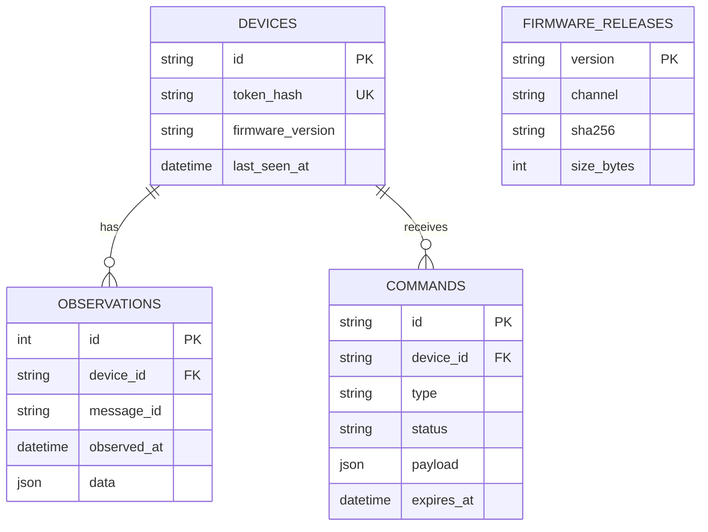

# Server architecture

## Layers

```text
server/
├── src/akashavani_server/
│   ├── main.py          app factory, lifespan, router wiring
│   ├── config.py        pydantic-settings (AKASHAVANI_*)
│   ├── db.py            engine/session, Base
│   ├── models.py        SQLAlchemy tables
│   ├── schemas.py       Pydantic request/response contracts
│   ├── security.py      token hashing, device/admin auth, seed devices
│   ├── api/             health, observations, commands, firmware, admin
│   └── services/        reserved for domain logic as it grows
├── migrations/          Alembic
├── tests/               pytest + TestClient + schema validation
├── Dockerfile
└── docker-compose.yml
```

Routers stay thin; domain logic moves into `services/` when it no longer fits in
a single transaction.

## Data model



The unique constraint `(device_id, message_id)` is the idempotency mechanism.
A retry returns `200` with `duplicate: true`; a new record returns `202`.

## Request flow: ingest

1. Authenticate `X-Device-Token` by SHA-256 hash lookup.
2. Read the raw body with a configured size limit.
3. Decode JSON or CBOR and validate against the observation schema in
   `schemas.py`.
4. Reject a `device_id` that does not match the authenticated device.
5. Reject timestamps too far in the future.
6. Insert, handling a concurrent duplicate as success.
7. Update `last_seen_at` and the reported firmware version.

CBOR is decoded only after reading the raw body, so FastAPI cannot parse the
payload first. This is deliberate: one code path enforces size, content type and
schema errors consistently.

## Request flow: commands

- Admin enqueues a command with a TTL.
- Device leases up to `limit` pending, unexpired commands. Leasing marks them
  `delivered` in the same transaction.
- Device acknowledges with `ok` or `error` plus a JSON `result`; the endpoint is
  idempotent.
- Postgres uses `FOR UPDATE SKIP LOCKED` for concurrent leases. SQLite ignores
  the clause and is intended for a single worker in development.
- For `download_new_fw`, the admin enqueue endpoint fills `url`, `sha256` and
  `size_bytes` from the selected firmware release so the device never invents
  download details. `get_config`, `reboot`, `sync_time` and `boot_with_new_fw`
  carry no payload beyond an optional version; `push_config` carries the full
  device configuration document.

## Request flow: OTA

1. Admin uploads an image with `POST /api/v1/admin/firmware/upload`
   (multipart) or registers an existing file; the server computes SHA-256.
2. Admin queues `download_new_fw` for a device. The server fills the release URL,
   hash and size.
3. Device streams the image with its token, verifies SHA-256, and writes the
   inactive slot. It does not change the boot partition.
4. Admin queues `boot_with_new_fw`; the device checks the NVS staged version,
   selects the slot, acknowledges, and restarts.
5. The next request carries `X-Firmware-Version`, updating the device row.

The `/api/v1/firmware/check` endpoint remains for LAN/legacy use. Devices still
do not verify a signature, only the SHA-256; TLS pinning and rollback remain
release blockers. See [OTA](../operations/ota.md).

## Auth model

| Principal | Credential | Storage |
| --- | --- | --- |
| Device | `X-Device-Token` bearer | SHA-256 hash in `devices.token_hash` |
| Admin | `Authorization: Bearer ...` | `AKASHAVANI_ADMIN_TOKEN` environment variable |

Authenticated device requests also carry `X-Device-Mac`,
`X-Firmware-Version`, `X-Last-Radio-At` and health headers (`X-Uptime-Seconds`,
`X-Queue-Depth`, `X-Free-Heap`, `X-Wifi-Rssi`, `X-Reset-Reason`). The server
records them (and `last_seen_at`) on the device row for admin display. A device is shown as
*online* when `last_seen_at` is within 90 s (three 30 s poll intervals);
`last_radio_at` is independent and stays old when RF is lost.

Seed devices are created from `AKASHAVANI_DEVICE_SEEDS` on startup only if
missing. Restarting never rotates a token. Use the admin API to rotate
explicitly.

## Database

- Development default: SQLite at `data/akashavani.db`, one worker.
- Production: PostgreSQL via `AKASHAVANI_DATABASE_URL`, run multiple workers only
  after validating command leasing against Postgres.
- Alembic is the schema mechanism. The application creates tables automatically
  only when `environment=test`.
- The Docker entrypoint runs `alembic upgrade head` before Uvicorn.
- Every stored and transported timestamp is UTC (epoch integers or `...Z`
  strings). A device's `timezone` column is an IANA name used only for
  operator-facing rendering and CSV export; it never changes stored values.
- `devices.config` is the server mirror of the device-owned configuration
  document. Site coordinates are extracted into `latitude`, `longitude` and
  `altitude_m`; archive derivations use `altitude_m` and store `NULL` when it is
  unknown.
- Archive rows also store the per-bucket invalid-frame RSSI summary in
  `crc_bad_rssi_min_dbm`, `crc_bad_rssi_avg_dbm` and `crc_bad_rssi_max_dbm`.

## Scaling notes

- Observations are append-only and can be partitioned by device/time later.
- Command leasing is the first contention point; use Postgres row locks and
  short transactions.
- Firmware images are files on disk in this scaffold. Move to object storage
  behind the same API when the fleet grows.
- The admin surface is intentionally small; put it behind the same reverse proxy
  and network policy as the API.
